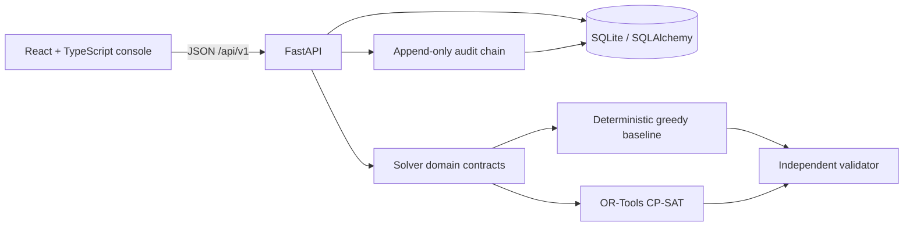

# Architecture

The optimization package (`backend/app/optimization`) has no FastAPI, SQLAlchemy, or React imports. It uses immutable dataclasses and integer-minute intervals. Persistence is the source of truth for saved entities. A solve creates a proposal/run manifest; only the approval endpoint applies a validated proposal.

## Trust boundaries

- Synthetic seed data and synthetic restriction adapters only; no external operational source adapters are connected.
- Solver output is untrusted until the independent validator returns `valid=true`.
- UI status labels are informative; approval rules are enforced server-side.
- Audit hash chains are tamper-evident, not an authenticated append-only ledger against a privileged full-database rewrite.
