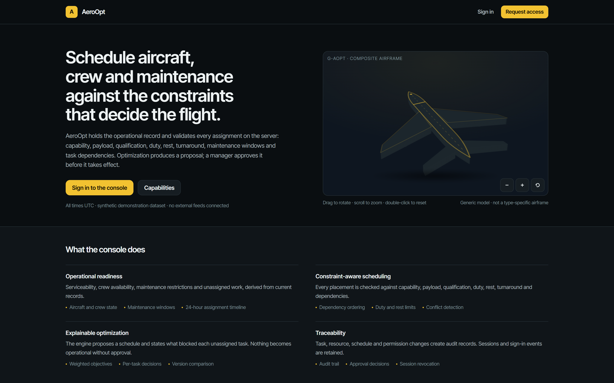
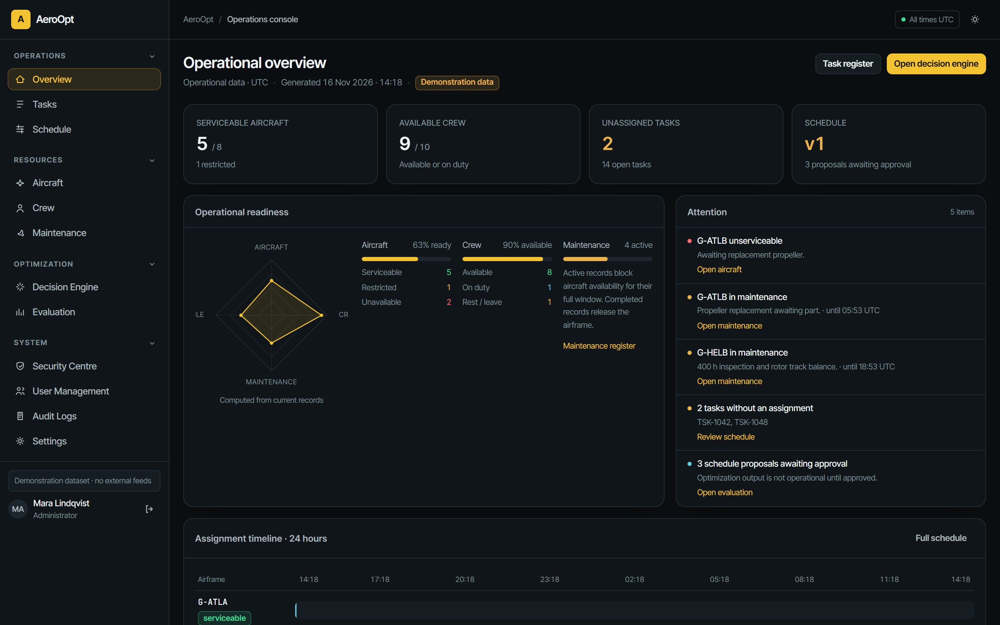
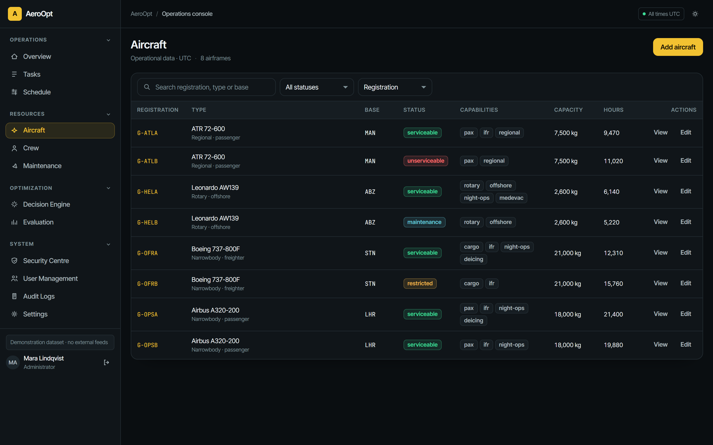
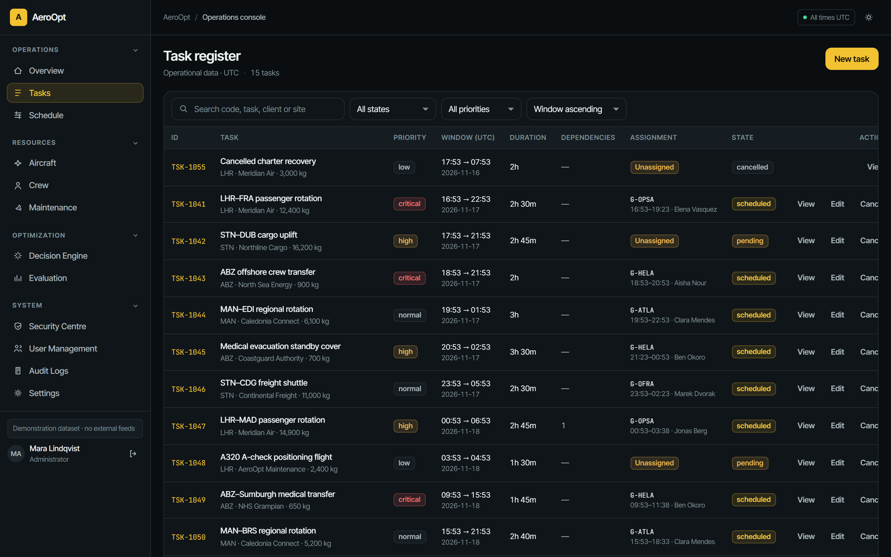
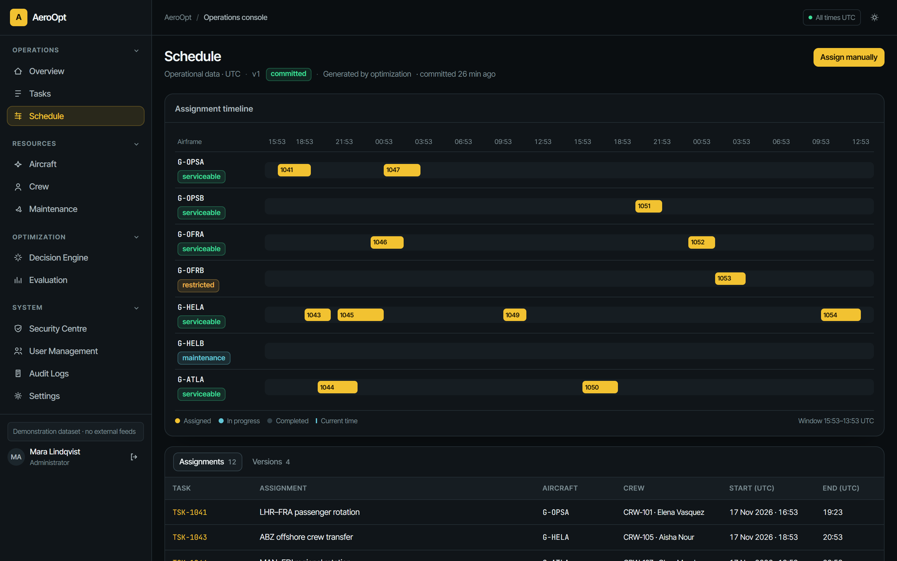
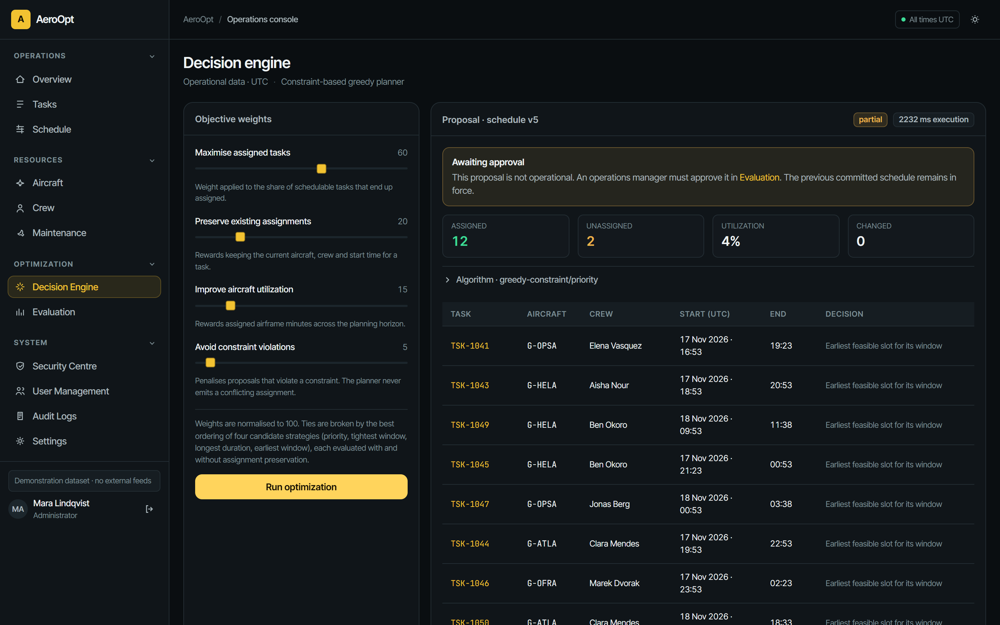
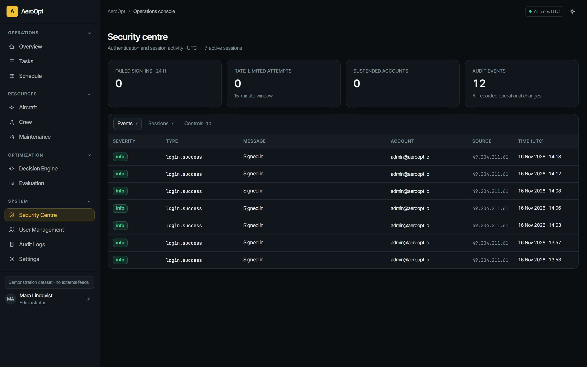

# AeroOpt

**Aviation operations and scheduling platform** — aircraft readiness, crew coordination, task management and constraint-based schedule optimisation in one console.

AeroOpt holds the operational record and answers the only question that matters: *can this task actually fly, with this aircraft and this crew?* Every assignment is checked server-side against aircraft state, maintenance windows, capabilities, payload, crew qualifications, duty and rest limits, turnaround and task dependencies. Optimization produces a proposal — an authorised manager approves it before it becomes operational.

> **Live demo:** https://site-6b4858e07ae54a00be427ec8cfa46142.freebuff.page
> The deployment runs on a **synthetic demonstration dataset**. No external aviation feed is connected and the data is not operational.



## Contents

- [Product overview](#product-overview)
- [Screens](#screens)
- [Core features](#core-features)
- [Technology stack](#technology-stack)
- [Architecture](#architecture)
- [Data model](#data-model)
- [Scheduling and optimization](#scheduling-and-optimization)
- [Authentication and permissions](#authentication-and-permissions)
- [Installation](#installation)
- [Environment configuration](#environment-configuration)
- [Local development](#local-development)
- [Deployment](#deployment)
- [Tests](#tests)
- [Security considerations](#security-considerations)
- [Motion system](#motion-system)
- [Known limitations](#known-limitations)

## Product overview

A dispatcher receives a task — a passenger rotation, a cargo uplift, an offshore crew transfer, a medical transfer. Whether it can be flown depends on a chain of constraints that usually live in spreadsheets and memory: is the airframe serviceable, is it in maintenance, does it have the capability set and payload capacity, is a qualified crew available inside a legal duty window, and has the task it depends on been completed?

AeroOpt keeps those facts in one schema, evaluates them with a deterministic engine, and shows the result: which tasks are assigned, which are not, and *which constraint blocked each one*. Optimization builds candidate schedules, scores them against operator-weighted objectives, and stores the proposal with its explanation. Committing a schedule is an approval, not an automatic write.

## Screens

| | |
| --- | --- |
|  **Operational overview** — readiness dial, attention queue, assignment timeline |  **Aircraft register** — serviceability, maintenance state, capability set |
|  **Task register** — priority, window, duration, assignment, state |  **Schedule** — 24-hour timeline per airframe |
|  **Decision engine** — objective weights, scored proposal, per-task explanation |  **Security centre** — sessions, sign-in events, control coverage |

The 3D airframe viewer (CSS 3D, dependency-free) appears on the landing page and on each aircraft record.

## Core features

- **Operational overview** — serviceable fleet, available crew, unassigned tasks, schedule version, readiness dial and an attention queue derived from live records.
- **Task register** — full lifecycle (draft → pending → scheduled → in progress → completed, plus cancelled/blocked), priority, time window, duration, payload, required capabilities and qualifications, dependencies.
- **Aircraft and crew registers** — serviceability, base, capabilities, flight hours; crew roles, qualifications, certification expiry, availability window, duty limit and rest.
- **Maintenance** — scheduled, unscheduled and inspection records that restrict the aircraft they touch until completed.
- **Scheduling** — committed schedule with version history, a 24-hour assignment timeline, manual assignment with constraint explanation, drafts, and proposal comparison.
- **Decision engine** — weighted objectives (assigned share, preservation, utilisation, violations) across four task orderings, each with and without preserving existing assignments; records algorithm, score, feasibility, changed assignments and per-task reasoning.
- **Evaluation and approvals** — proposal diff against the committed schedule, independent assignment audit, and an approval step that only an authorised role can perform.
- **Users, roles and audit** — six roles enforced in the API, session management and revocation, audit events for every operational write, security events for authentication.
- **Responsive console** — 320 px through 1920 px, light and dark themes, reduced-motion setting.

## Technology stack

| Layer | Choice |
| --- | --- |
| Frontend | React 19, react-router 8, Tailwind CSS 4 with semantic tokens, Vite 8 |
| Animation | Motion (`motion/react`) plus CSS transitions, centralised tokens |
| API | Hono 4 on a Cloudflare Worker |
| Database | Cloudflare D1 (SQLite), parameterised SQL, idempotent versioned bootstrap |
| Domain engines | Pure TypeScript in `src/shared/engine.ts`, shared by the Worker and the tests |
| Auth | WebCrypto: PBKDF2-SHA256 passwords, SHA-256 hashed opaque session tokens |
| Tests | Vitest, 50 tests against a real SQLite database via a D1-compatible adapter |

## Architecture

```text
src/
  shared/      domain types, constraint engine, validation, permissions, formatting
  worker/      Hono app, auth, D1 schema + seed, serializers, route modules
  components/  design system, app shell, timeline, readiness dial, airframe viewer
  pages/       public pages, auth pages, console pages
tests/         engine tests, API tests, SQLite-backed D1 adapter
```

The Worker handles `/api/*` first and serves the built client through the `ASSETS` binding behind it (SPA fallback). Pages are code-split; the console is a single shell with grouped navigation. All business rules, permissions and validation run server-side — the client renders what the API returns.

### API surface

`/api/auth/*` sign-in, sign-up, sign-out, session, password recovery/reset, session revocation, re-authentication.
`/api/overview`, `/api/tasks`, `/api/aircraft`, `/api/crew`, `/api/maintenance`, `/api/schedule` (+ versions, draft, assign, commit, discard), `/api/optimize` (run, runs), `/api/approvals`, `/api/analytics`, `/api/users`, `/api/audit`, `/api/security`, `/api/settings`, `/api/meta`.

Every route except `/api/health` and the public auth entry points requires a session; every write additionally checks a permission and the request origin.

## Data model

`users`, `sessions`, `password_resets`, `login_attempts`, `aircraft`, `crew`, `maintenance`, `tasks`, `task_dependencies`, `schedules`, `assignments`, `optimization_runs`, `approvals`, `audit_events`, `security_events`, `settings`, `meta`.

Foreign keys enforce referential integrity; multi-record writes are issued as D1 batches. Schema creation and seeding are idempotent and versioned in `meta.schema_version`, so the platform bootstraps itself on first request in a new environment. The demonstration set contains 8 aircraft, 10 crew, 15 tasks (including one cancelled), 4 maintenance records and a committed schedule generated by the real planner at seed time.

## Scheduling and optimization

**Constraint evaluation** (`evaluatePlacement`) checks: task window, aircraft status, maintenance overlap, capability set, payload capacity, crew status, crew availability window, qualification set, certification expiry, aircraft and crew double-booking, turnaround gap, crew gap, duty limit per UTC day, and dependency completion order.

**Planner** (`planSchedule`) orders tasks dependency-first with a configurable tie-break (priority, tightest window, duration, earliest window), scans candidate start slots in configurable steps and chooses the earliest feasible aircraft/crew pairing. Unplaceable tasks stay unassigned and carry the dominant blocking constraint.

**Optimization** (`optimize`) evaluates four orderings, each with and without preservation of existing assignments, and scores:

```text
score = (assigned·assignedShare + utilization·utilizationShare
        + preserve·preservedShare − conflicts·violationShare) / Σweights
```

Weights are operator-supplied (0–100). The winning run stores its algorithm, ordering, score, objective, feasibility, per-task explanation, execution duration and changed assignments.

**Approval** — a run creates a `proposed` schedule plus a pending approval. Only `schedule:approve` commits it; committing supersedes the previous schedule (kept for comparison), marks assigned tasks `scheduled`, resolves the approval and writes audit records. Feasibility reflects configured rules only — it is not an airworthiness, regulatory or safety clearance.

## Authentication and permissions

Opaque 256-bit session tokens are stored as SHA-256 hashes in `sessions` and sent in an `HttpOnly`, `SameSite=Lax` cookie (`Secure` on HTTPS), expiring after the configured number of hours (default 12). Passwords use PBKDF2-SHA256 with 100,000 iterations (the platform ceiling for WebCrypto in Workers) and a per-user salt; the iteration count is stored with each hash. Failed sign-ins are rate limited per email and IP within a 15-minute window. Password reset revokes all sessions; suspension revokes sessions and blocks sign-in.

| Role | Capability |
| --- | --- |
| Administrator | Everything, including users, permissions, settings, security, audit |
| Operations Manager | Tasks, schedule, optimization, schedule approval, audit |
| Dispatcher | Tasks, schedule, optimization |
| Maintenance Officer | Maintenance records and aircraft state |
| Crew Coordinator | Crew records, availability, qualifications |
| Viewer | Read-only |

Public sign-up can only create a Viewer or Dispatcher; elevated roles are assigned inside the console. The last active administrator cannot be demoted or suspended.

## Installation

Requires Node.js 20+ (developed on Node 24) and npm.

```sh
git clone <repository-url>
cd AeroOpt
npm install --no-package-lock     # bun is not installed in this environment
```

`--no-package-lock` keeps the tracked `bun.lock` as the single lockfile; npm will not write its own.

## Environment configuration

No secrets are required and none are committed. Copy `.env.example` to `.env` only if you need to override a value:

| Variable | Purpose |
| --- | --- |
| `ENVIRONMENT` | Set to `production` to enable HSTS and production-only behaviour |
| `DB` (binding) | D1 database; provisioned locally by the Cloudflare Vite plugin, attached on deploy |
| `ASSETS` (binding) | Static asset binding used for SPA fallback |

The frontend always calls its own origin (`/api/*`), so no API base URL is embedded in the build and no `VITE_*` secret exists to leak.

## Local development

```sh
npm run dev        # http://localhost:5305 (Vite + Worker + local D1)
npm run typecheck  # tsc --noEmit
npm test           # 50 tests: constraint engine + API
npm run build      # dist/client (assets) + dist/aeroopt/index.js (Worker)
```

Schema and demo data are created automatically on the first API request. To start from a clean dataset, stop the server and delete `.wrangler/state`.

### Demonstration accounts

Password for every account: `AeroOpt#2026`

| Email | Role |
| --- | --- |
| admin@aeroopt.io | Administrator |
| ops@aeroopt.io | Operations Manager |
| dispatch@aeroopt.io | Dispatcher |
| maintenance@aeroopt.io | Maintenance Officer |
| crew@aeroopt.io | Crew Coordinator |
| viewer@aeroopt.io | Viewer |

## Deployment

The application is a static client plus a Cloudflare Worker API with a D1 database. It deploys as one unit:

```sh
npm run build          # writes dist/client and dist/aeroopt/index.js
# then upload both, per deploy.json, to a Worker with a D1 binding named DB
```

`deploy.json` describes the entrypoint, compatibility date, module and asset directory for the uploader. `wrangler.jsonc` carries a placeholder `database_id` for local development only — a hosted environment attaches its own database to the same `DB` binding name.

**Why not Vercel for this build:** the API is a Hono Worker that talks to D1 through the `DB` binding and relies on Workers' WebCrypto, so it cannot run as a Vercel serverless function. A Vercel deployment of the frontend alone would have no API and no session cookies. Hosting on Vercel would require porting the API to Node (or another host) and replacing D1 with a hosted SQL database — an architectural change, not a configuration change. The live demonstration above is the deployed Worker itself.

## Tests

`npm test` runs 50 tests against a real SQLite database (`node:sqlite`) through a D1-compatible adapter:

- **Engine** — window, status, maintenance, capability, capacity, qualification, crew status, double-booking, duty limit, dependency ordering, overlap freedom, preservation weighting, feasibility reporting, independent assignment audit.
- **API** — anonymous rejection, cross-site rejection, sign-in/out, sign-up and duplicates, weak passwords, task CRUD/validation/transitions, RBAC per role, aircraft restrictions from maintenance, maintenance start/completion side effects, crew validation, optimization run → pending approval → commit, analytics, security reporting, last-admin protection, session revocation.

Release verification also exercises the deployed Worker: anonymous API calls return 401, viewer writes return 403, cross-origin writes return 403, and the deployed build was captured with zero console errors and zero failed requests.

## Security considerations

Enforced: parameterised SQL with a fixed sort-column allowlist; server-side validation on every write; same-origin enforcement on mutating requests; `X-Content-Type-Options`, `Referrer-Policy`, `X-Frame-Options`, `Permissions-Policy` (plus HSTS in production); `no-store` on API responses; safe error responses; audit and security event logging without secrets; generic sign-in errors; PBKDF2 password hashing with per-user salts; hashed session tokens; rate-limited sign-in.

Not configured, and reported as gaps in the Security Centre rather than faked: email delivery, dependency/secret scanning, scheduled backups, MFA.

## Motion system

All motion is centralised in `src/lib/motion.tsx`; components consume tokens and variants rather than inventing timings.

| Token | Value | Used for |
| --- | --- | --- |
| `micro` | 120 ms | press feedback, icon state change |
| `control` | 180 ms | list rows, small state swaps |
| `dropdown` | 200 ms | menus, popovers, selects |
| `standard` | 220 ms | cards, page entrances |
| `modal` | 260 ms | modal panels |
| `layout` | 300 ms | shared-layout and panel moves |

Entrances ease out, exits ease in at 80% of the entrance duration, movement uses ease-in-out, and no springs are used on operational UI. Table rows stagger 30 ms once per mount; the active console section and active tab use shared `layoutId` indicators; the airframe enters on a curved path and stops interpolating while dragged; timeline bars morph on `left`/`width`. `prefers-reduced-motion` collapses animations, and Settings → Interface → Motion sets a persisted reduced-effects preference.

## Known limitations

- MFA is not implemented; the columns exist for a future TOTP flow.
- There is no mail provider: password recovery returns a token in the UI in demonstration mode only (`demoData=true`). Administrators can reset passwords directly.
- No external aviation data feed; datasets are synthetic and labelled as such.
- Optimization is a greedy constrained planner, not an exact solver; it does not prove global optimality.
- The 3D airframe is a generic composite model (extruded SVG in CSS 3D), not a type-accurate airframe.
- Scheduling uses UTC only; no per-operator time zones or daylight-saving handling.
- No licence has been granted for reuse; the source is published for review and demonstration.

## Repository

- `deploy.json` — deployment manifest (entrypoint, assets, compatibility date)
- `wrangler.jsonc` — local Worker/D1 configuration
- `scripts/release-capture.mjs` — production screenshot and verification pass
- `scripts/release-carousel.mjs` — LinkedIn carousel renderer
- `release/` — screenshots, carousel slides, PDF and launch copy
